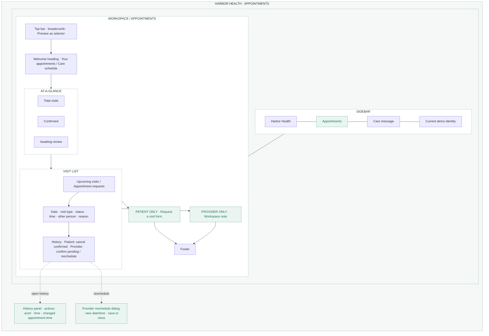
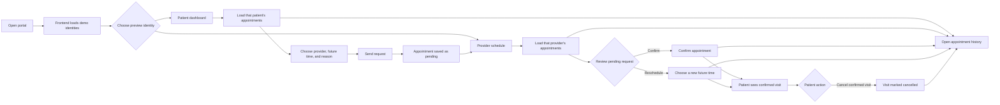

# Harbor Health project workflow

Harbor Health is a demo appointment portal with one React screen that changes
between patient and provider views. The diagram below is an original,
wireframe-style map of that screen; it is a guide to the interface, not a
production screenshot.

## Application wireframe

## How a request moves through the app

## End-to-end workflow

1. **Start the services.** The Vite frontend runs on port `5173` and calls the
   FastAPI backend on port `8000`. The frontend API base URL is
   `VITE_API_URL`, falling back to `http://localhost:8000/api`.
2. **Initialize data.** On backend startup, SQLite creates or migrates its
   database, seeds the demo patients, providers, and sample visits, and starts
   a background worker for queued notification records.
3. **Load the workspace.** The frontend fetches `/api/demo-users`, then fetches
   `/api/appointments` for the currently selected role and user. Changing
   **Preview as** switches between the patient and provider workspaces and
   loads the selected user's appointments. The schedule refreshes every five
   seconds.
4. **Request a visit (patient).** The patient chooses a provider, a future
   date/time, and a reason. The UI sends `POST /api/appointments`; the API
   validates the input and identity, saves a `pending` appointment, and records
   a `requested` history event. The refreshed patient list shows it.
5. **Review and act (provider).** The provider's list includes appointments
   assigned to that provider. A provider can confirm a pending visit or open
   the reschedule dialog for an active visit. These actions use
   `PATCH /api/appointments/{id}` and include the appointment version seen by
   the UI.
6. **Notify and refresh.** Confirming a visit writes a notification to the
   database outbox in the same transaction as the appointment update. The
   background worker claims queued notifications and processes them; this demo
   logs delivery rather than sending a real email or text. The UI shows a
   confirmation notice and reloads the schedule.
7. **Cancel (patient).** A patient can cancel a confirmed visit. The API
   validates that the selected patient owns the appointment, marks it
   `cancelled`, and writes a history event. The patient's upcoming list hides
   cancelled and past visits.
8. **Inspect history.** Selecting **History** loads
   `/api/appointments/{id}/history` and displays the recorded action, actor,
   timestamp, and appointment snapshots (including a time change when one
   occurred).

## API and data responsibilities

| Request | Purpose |
| --- | --- |
| `GET /api/health` | Service health check |
| `GET /api/demo-users` | Populate patient/provider identity options |
| `GET /api/appointments?role=…&user_id=…` | Load a scoped appointment list |
| `POST /api/appointments` | Create a pending visit request |
| `PATCH /api/appointments/{id}` | Confirm, cancel, or reschedule a visit |
| `GET /api/appointments/{id}/history?role=…&user_id=…` | Read the visit audit history |

SQLite stores demo users, appointments, appointment history events, and
notification-outbox rows. Appointment updates run in transactions and increment
a version. If another update has changed that version, the API returns
`409 Conflict` and the frontend reloads the latest appointment for review.
Database triggers prevent overlapping confirmed appointments for the same
provider based on appointment duration; back-to-back visits are allowed, and no
additional 30-minute buffer is applied.

## Demo scope and limitations

- **Preview as** is identity switching for the demo, not login or authorization.
- Notifications are logged by the worker, not sent through a real messaging
  service.
- SQLite is suitable for local use and disposable demos; hosting storage may be
  ephemeral unless a persistent disk is configured.
- Do not use this demo for real patient information or clinical operations
  without production-grade identity, authorization, privacy, security, backup,
  and regulatory work.
